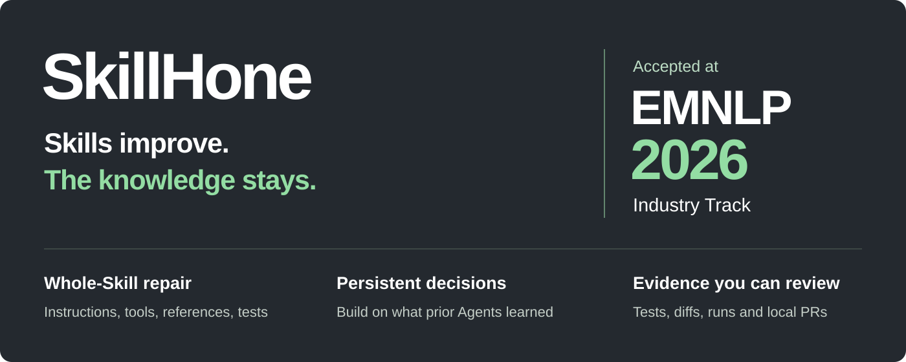
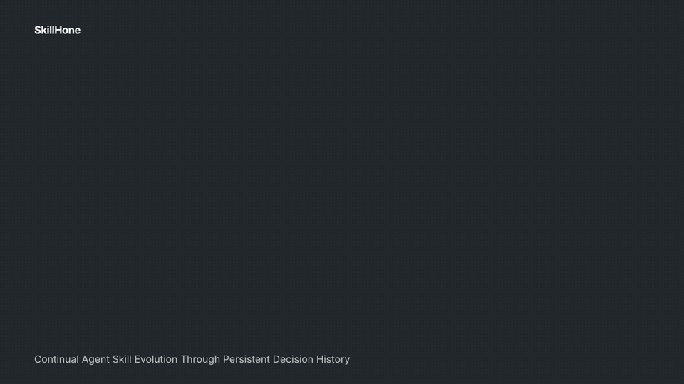

# SkillHone

**Continually improve your Agent Skills — and keep what was learned.**

[Get started](#get-started) · [中文](docs/README.zh.md) ·
[Public example](examples/phoenix-tracing/) · [Paper](https://aclanthology.org/2026.emnlp-industry.105/)

**Accepted at EMNLP 2026 Industry Track.** The paper reports **+15.8 points on
GAIA** and **+3.2 points on WebWalkerQA-EN** against its commercially backed
deep-research baseline, without a pre-integrated search stack.
[Read the paper and evaluation context](https://aclanthology.org/2026.emnlp-industry.105/).

An Agent hits a missing script, a broken reference, or an outdated instruction.
SkillHone captures the evidence, repairs the **complete Skill repository**, and
returns a tested local PR. The Issue, test, diff, run and decision stay together,
so the next Agent can build on what was learned.

Works with CLI-capable Agents, including **Codex, Claude Code, Cursor, Pi and
ZCode**. DeepSeek Harness runs the repairs; your Agent reports the problem.

## Get started

Give your coding Agent this prompt:

> Install SkillHone from `https://github.com/zwliJay/SkillHone`, following
> `docs/install/skillhone.md`. Make the CLI and Skills available to this Agent,
> use the documented `--install-links=true` Git installation command, and
> verify the installation.

Prefer the terminal? Start with the [installation guide](docs/install/skillhone.md)
for installation, provider configuration, and verification.

## SkillHone in 35 seconds

35-second silent loop. Shows the current workbench and actual local repair records; benchmark gains are from the paper.

Inspect the current workbench

See which Skills need attention, expand their repair records, and inspect each local PR before merging.

**Reproduce a real repair.** The [Phoenix tracing walkthrough](examples/phoenix-tracing/) starts with four referenced documents that were never shipped, then follows the failure, regression test and repair evidence. Public source: [Issue #2567](https://github.com/github/awesome-copilot/issues/2567) · [merged fix #2568](https://github.com/github/awesome-copilot/pull/2568).

## What stays with the fix

| You need | SkillHone keeps |
|---|---|
| A problem the next Agent can reproduce | One Issue with sanitized evidence and a linked regression test |
| A complete repair | Changes to `SKILL.md`, scripts, references, assets and tests in one Git diff |
| A result you can review | Test outcomes, repair run, commits and a local PR |
| A reason the next Agent can reuse | Per-Skill Wiki records and persistent decision history |

Repairs use isolated branches. **Review is the default**; automatic local merge
is opt-in and requires linked tests to pass. Pushing remains a separate user
action. The [local workbench](docs/install/developer.md#run-the-workbench) brings
Issues, runs, PRs, approval state and Wiki records into one view.

## Two ways to improve a Skill

| | Runtime maintenance | Evaluation-driven optimization |
|---|---|---|
| Start with | A reproducible failure encountered during real work | A frozen dataset and verifier in a separate Eval repository |
| Use it for | Missing files, broken scripts, stale instructions and API drift | Broader capability and quality improvements |
| Review | Issue, regression, repair and local PR | Baseline, candidate iterations, validation and local PR |
| Learn more | [Runtime workflow](skills/skillhone-auto-optimization/SKILL.md) | [Benchmark workflow](docs/benchmark-optimization.md) |

## Research and citation

> Zhiwei Li and Yong Hu. *SkillHone: A Harness for Continual Agent Skill
> Evolution Through Persistent Decision History.* EMNLP 2026 Industry Track.
> [ACL Anthology](https://aclanthology.org/2026.emnlp-industry.105/) · [arXiv:2606.08671](https://arxiv.org/abs/2606.08671)

[BibTeX](docs/skillhone.bib) · [CITATION.cff](CITATION.cff)

[Security](SECURITY.md) · [Contributing](CONTRIBUTING.md) ·
[MIT License](LICENSE) · [Third-party notices](THIRD_PARTY_NOTICES.md)
